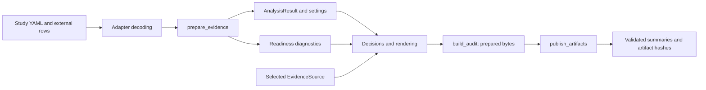

# Architecture and change recipes

`eval-audit` evaluates declared benchmark claims. It does not run benchmarks or rank models across harnesses.

## Ownership

| Owner | Responsibility | Change here |
| --- | --- | --- |
| `schema/` | Persisted study, row, and summary contracts | Add fields, validated vocabulary, or format constraints |
| `ingest/` | Decode source-specific representations into canonical rows | Add an adapter, without changing canonical semantics |
| `evidence.py` | Revalidate and scope evidence, then establish comparability | Change observation identity, task pairing, or replication guarantees |
| `stats/` | Inference, declared accounting policy, and whole-study sensitivity | Change statistical behavior with explicit methodology evidence |
| `report/provenance.py`, `scouting_paths.py` | Bind selected input to receipts and known residual-risk documents | Add a concrete source binding |
| `report/` | Explain one analysis and its assumptions | Change decision wording or presentation |
| `pipeline.py` | Choose the evidence source, gate readiness and verdicts, and build one complete artifact set without filesystem writes | Change workflow composition, source selection, or gate rules |
| `artifacts.py` | Containment, writer ownership, publication, and rollback | Change artifact lifetime or completion behavior |
| `portfolio.py` | Inspect completed, stale, incomplete, and invalid audits | Change evidence-index behavior |
| `cli.py` | Parse arguments, print results, and report errors | Add a user operation through existing owners |
| `tools/fixture_io.py` | Cached source bytes, receipts, and fixture promotion | Change reusable regeneration mechanics |

`prepare_evidence` owns a revalidated study copy and a scoped canonical frame.
Its internal consumers must not mutate either. The contained objects are not deeply immutable.
Every declared agent passes comparability checks, including agents used only by Pareto analysis.
Unrelated agents are reported as excluded. They cannot change the declared comparison.

One `AnalysisSettings` value records alpha, bootstrap iterations, and seed.
Reports derive settings from the result and reject contradictory overrides.
Task means use one sorted pairing implementation for bootstrap intervals and paired tests.
Sensitivity scenarios recompute the whole declared family. An unavailable scenario has no verdict.

The input source describes the actual loaded file and its hash.
Canonical BYO files do not inherit adapter receipts through their benchmark name.
Known residual-risk documents require an explicit fixture and study binding.

## Artifact lifetime

`build_audit` finishes validation, analysis, and rendering before publication starts.
`publish_artifacts` serializes writers with a per-study file lock.
It stages bytes, creates `.incomplete`, replaces owned files, and publishes `summary.json` last.
Successful completion removes the marker. Ordinary write failures restore the previous generation.
Process interruption leaves an inspectable incomplete audit. Re-run the audit to repair it.
Readers exclude internal staging directories and validate artifact hashes.
They cannot treat partial output as a completed audit.

This protocol supports local filesystems. It is not a distributed transaction or a network-filesystem locking guarantee.
Unrelated files remain untouched. Symlinked owned artifacts and output-root escapes are rejected.
`analyze` publishes only analysis and invalidates any prior completion summary.

## Make a correct change

1. Read the matching design document and identify the authoritative owner above.
2. Inspect the contract with `uv run --locked eval-audit spec schema --model study|run|summary`.
   Choose one model name. The CLI derives JSON Schema directly from Pydantic.
3. Add behavior at that owner. Keep adapters limited to source-specific decoding.
4. Run the focused command below. Include a concrete wrong-input or failure case for changed guarantees.
5. Review generated report differences before regenerating committed reports.
6. Run `make check`. Independent review handles methodology and tradeoffs that checks cannot decide.

| Change | Focused check |
| --- | --- |
| Canonical input or comparability | `uv run --locked pytest tests/schema tests/ingest tests/test_evidence.py` |
| Inference or sensitivity | `uv run --locked pytest tests/stats tests/report/test_analysis_settings.py` and `make slow` |
| Publication or portfolio | `uv run --locked pytest tests/test_artifacts.py tests/cli/test_portfolio_cmd.py` |
| CLI or template | `uv run --locked pytest tests/cli` and `make slow` |
| Fixture or historical harness | `uv run --locked pytest tests/scouting` |
| Report wording or provenance | `uv run --locked pytest tests/report` |
| Complete verification | `make check` |

Use `make setup` before verification. Missing caches or prerequisites fail visibly.
A successful local check does not certify a different OS, live provider, or refreshed dataset.

## Enforcement choices

Architecture removes duplicate validation, competing settings, implicit source lookup, and uncontrolled publication.
Pydantic enforces external values. Static types constrain internal interfaces.
The remaining checks serve requirements those mechanisms cannot establish alone:

| Guardrail | Why architecture or types are insufficient |
| --- | --- |
| Evidence failure cases | Correctly typed rows can still disagree on task sets, replication, or run totals |
| Statistical recovery and finite calibration | Types cannot establish estimator behavior under known data-generating processes |
| Fault injection and publication tests | Filesystems can fail or interrupt valid operations |
| Wheel smoke test | Source imports cannot prove packaged resources and runtime-only installation work |
| Fixture replay tests | Typed I/O cannot prove source hashes, decoding, or rollback behavior |
| Reviewed committed reports | Types cannot establish that prose accurately communicates numerical conclusions |
| Ruff, basedpyright, import-linter, lock checks in CI | These enforce source-wide properties and reproducible resolution beyond a runtime boundary |
| Architecture documentation | Ownership intent and methodology tradeoffs require human-readable explanations |
| Independent review | Review evaluates assumptions and evidence quality that deterministic checks cannot decide |

Do not replace these owners with repeated prose warnings. Add checks only for a demonstrated failure or stated guarantee.
